

  <a href="https://rishfotech.com"></a>

  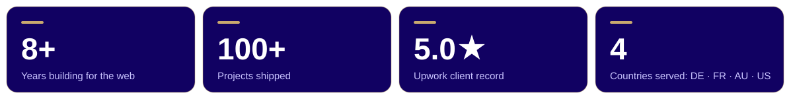

 

I run **[Rishfotech Solutions](https://rishfotech.com)**, a web development and digital marketing agency in Kolkata. My team builds for clients in Germany, France, Australia and the US, and we also work white-label behind other agencies. I still write code myself every week.

  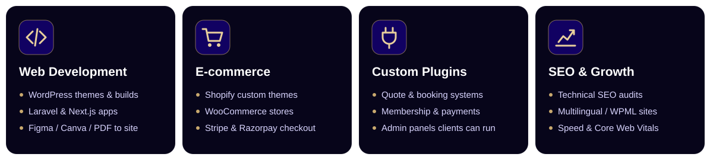

 

Live sites my team and I have designed and built. Click a card to open the site.

  <a href="https://thermocon-coldchain.com">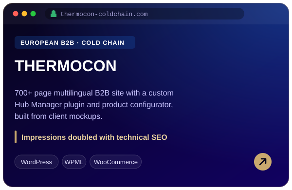</a>
  <a href="https://prachishahlaw.com">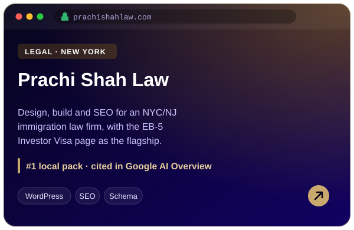</a>

  <a href="https://motusaiengine-alpha.vercel.app">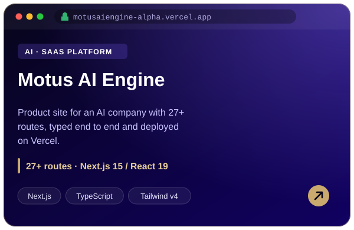</a>
  <a href="https://firsteditasia.com">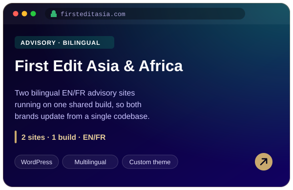</a>

  <a href="https://alasconstruct.au">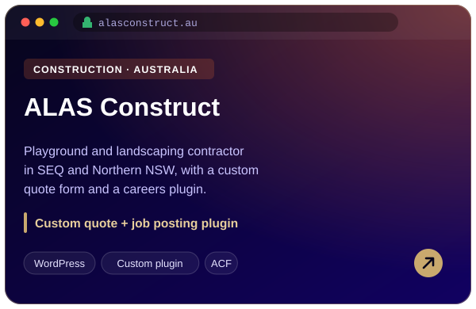</a>
  <a href="https://legendscreekfarm.com">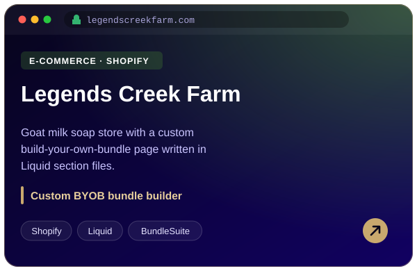</a>

  <a href="https://frenchetvoila.com/fall-program-2026/">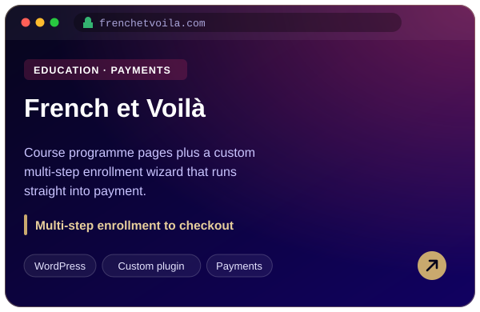</a>
  <a href="https://alpanaartagency.com">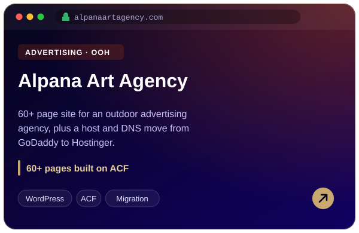</a>

<b>More work</b>

 

| Project | What we built |
|---|---|
| [Iseline Gandaho](https://iselinegandaho.com) | Premium editorial personal brand, built 1:1 from Figma in Elementor |
| [Rogers Morris](https://rogersmorris.com.au) | Module-based platform with about 25 modules, gated content and WooCommerce payments |
| [H2K Infosys](https://h2kinfosys.com) | IT training LMS with a custom Vue.js live classes feature |
| [Happy Hookie](https://happyhookie.com) | Shopify lifestyle store on a custom theme |
| [Carport Sylvasun](https://carport-sylvasun.fr) and [L.A. Solaire](https://la-solaire-71.fr) | French solar carport brand and photovoltaic installer |
| [Plumb Renovations](https://plumbrenovations.com.au) | Australian home renovation site with a quote form |
| [MyTutors](https://app.mytutors.co.in) | Tutor marketplace with location-based search |
| Wind of Change | Restaurant site plus a full CRM and loyalty management system (WordPress and Laravel) |

 

  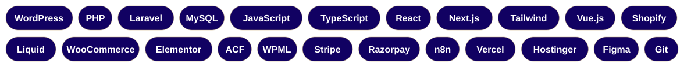

 

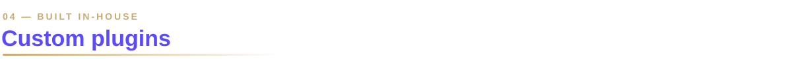

I prefer custom code over stacks of paid plugins. Each of these comes with an admin screen the client can run without a developer.

  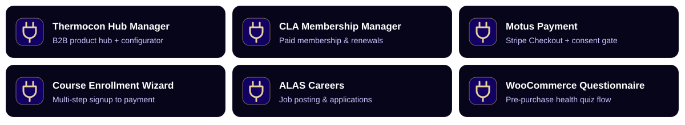

Most of our code lives in private client repos, so this profile shows the work rather than the commit graph.

  

  &nbsp;
  &nbsp;
  

 

  

